# Confronto visivo della prova giocabile (22 ottobre 2026)

| Unica tavola approvata | Screenshot reale del gioco, Chromium 1280×720 |
|---|---|
|  |  |

Questa prova si apre in `reference-play.html`. La tavola nel repository è un'anteprima WebP 720×405; l'originale ad alta risoluzione non era disponibile al momento del lavoro. Le immagini della tavola sono state usate **solo come riferimento**: non sono state incollate come fondale o UI del gioco.

## Valutazione franca

- **Camera e proporzioni:** vista alta obliqua ravvicinata su una porzione del negozio; Ipno, guardia, cliente e scaffali hanno scala umana simile alla tavola.
- **Colori e materiali:** frigoriferi freddi blu/ciano, cioccolata viola/rossa/oro, pavimento ambrato con riflessi e interno scuro. I materiali sono derivati dalla sola tavola approvata.
- **Gameplay visibile:** minimappa, pattuglia POLICIE, CCTV e coni rossi, cioccolata realmente sullo scaffale; movimento, copertura, prelievo e uscita sono interattivi.
- **Scarti ancora presenti:** gli scaffali sono 3D ma alcune facciate usano texture piane e ripetute; i personaggi sono piani illustrati in una scena 3D, senza un modello corporeo continuo da ogni angolo. La densità e la profondità delle merci non raggiungono ancora la tavola. L'anteprima 720 px non permette di trasferire esattamente ogni dettaglio. Le animazioni direzionali aggiunte nel lotto A sono descritte in fondo.
- **Prestazioni:** Chromium sul server EC2 usa rendering software e ha misurato 1–2 FPS; questa misura **non dimostra** le prestazioni su un telefono Android con GPU. Serve prova su dispositivo reale prima di dichiarare la resa mobile approvata.

**Aggiornamento dopo l'approvazione estetica di Simone (22/10):** la scena mostra quattro cioccolate su scaffali, due pattuglie e usa viste fronte/retro/profilo di Ipno, POLICIE e cliente. Le nuove viste seguono l'artboard, con costume e proporzioni confrontati alla stessa scala. Le geometrie e le texture degli scaffali sono ancora più ripetitive e meno profonde della tavola. Le viste laterali usano il riflesso per il lato opposto, e la cliente conserva un leggero alone scuro nei ritagli. Restano da misurare prestazioni e leggibilità su un telefono Android reale.

**Aggiornamento lotto A animazioni (22/10):** Ipno e POLICIE ora hanno quattro fotogrammi per camminata nelle quattro direzioni; Ipno ha passo accovacciato direzionale e prelievo fronte/retro/lato, gli agenti hanno corsa direzionale pronta per l'inseguimento. La [tavola di confronto delle animazioni](assets/reference-play/animation-comparison.png) mostra personaggi alla stessa scala; gli screenshot desktop e mobile qui sopra sono stati ricatturati dal gioco reale. Lo stile della tavola, i colori, le luci e la camera restano coerenti con la scena approvata. Persistono gli scarti strutturali già indicati: sprite piani, texture ripetute degli scaffali, tavola reference disponibile solo a 720 px. Nel browser software EC2 abbiamo misurato 1–2 FPS; un dispositivo Android reale non è stato ancora provato. Le pose di corsa verranno usate quando il lotto C introdurrà l'inseguimento.

**Stato:** scena giocabile per revisione del gameplay. `index.html` resta il gioco precedente finché i lotti narrativi e di punteggio non saranno integrati.

**Aggiornamento lotto B (22/10):** la superficie giocabile è passata da circa 114 a 440 m², con reparti cioccolato, dolci, alimentari, bevande, promozioni, frigoriferi e casse. Quattro espositori divisori aprono percorsi alternativi; alcuni scaffali diventano semitrasparenti solo quando coprono Ipno. Ci sono 18 posizioni candidate sui ripiani e 10 attive per partita; dopo 4 cioccolate si può uscire, le altre danno punti extra. Gli screenshot sopra sono stati ricatturati dalla mappa ampliata. Rispetto all'artboard approvata, la merce usa ancora texture ripetute e gli espositori aggiunti sono geometrici; le prestazioni su Android fisico restano da verificare.

**Aggiornamento lotto C (22/10):** l'interfaccia ora mostra chi ha visto il prelievo, le guardie che intervengono e l'ultima posizione nota sulla minimappa. Gli screenshot [POLICIE in inseguimento](assets/reference-play/policie-pursuit.png), [allarme CCTV desktop](assets/reference-play/cctv-alert.png) e [allarme CCTV mobile landscape](assets/reference-play/cctv-mobile-landscape.png) sono catture del gioco renderizzato in Chromium, con posizioni di prova impostate in modo riproducibile. La corsa usa gli sprite del lotto A; ambiente, personaggi e luce restano quelli derivati dalla sola artboard. L'unica camera CCTV e le facciate di scaffali ripetute restano una semplificazione rispetto alla ricchezza della tavola. Prova Android reale ancora mancante.

**Aggiornamento progressione infinita e joypad (22/10):** [screenshot desktop con 10 cioccolate, guardie e `!`](assets/reference-play/progression-desktop.png) e [screenshot mobile landscape con joypad](assets/reference-play/joypad-mobile-landscape.png) sono catture reali del browser. La scena, gli sprite e i prodotti conservano la sola artboard approvata come guida. Il nuovo `!` è un indicatore UI disegnato nel codice: non modifica i costumi dei personaggi. Le differenze visive dalla reference restano quelle già dichiarate sopra; non sono stati introdotti altri asset stilistici. La prova mobile è una viewport Chromium, non un Android fisico.

## Finali a Praga (#107) — confronto e prove visive

| Uscita volontaria a Praga | Cattura: ufficio POLICIE |
|---|---|
| 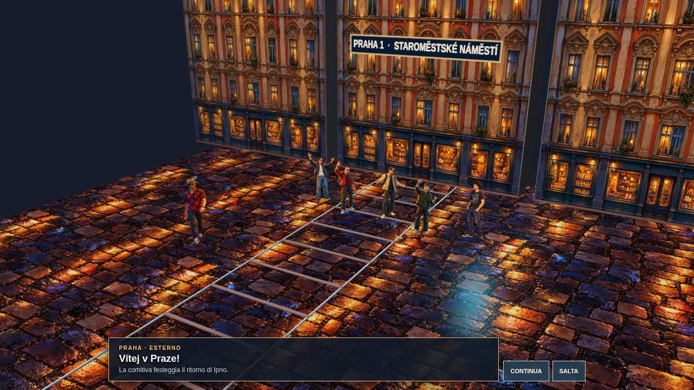 | 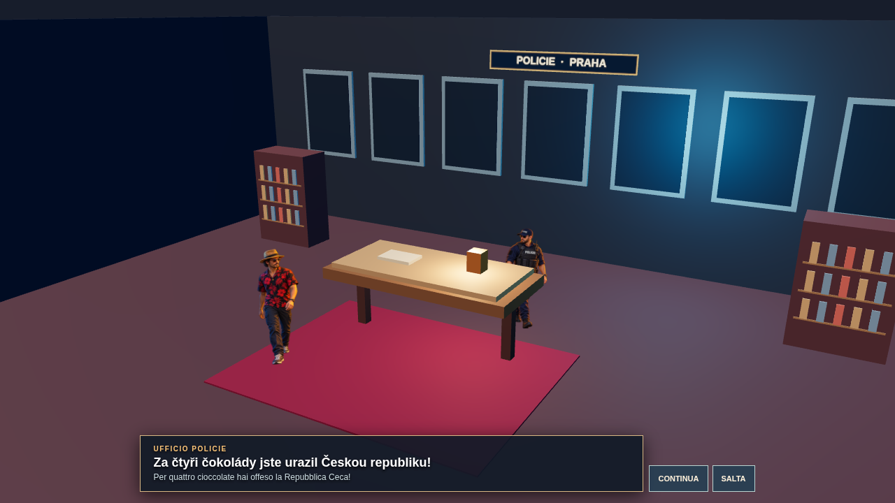 |

| Scala mobile | Multa in strada e cameo |
|---|---|
| 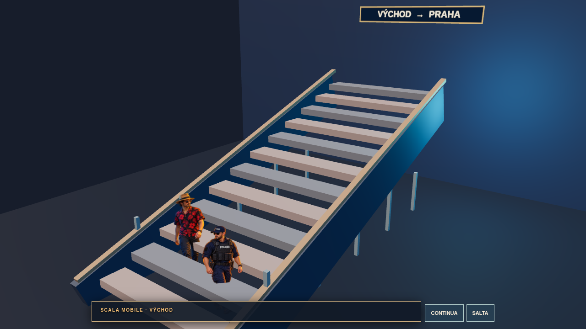 | 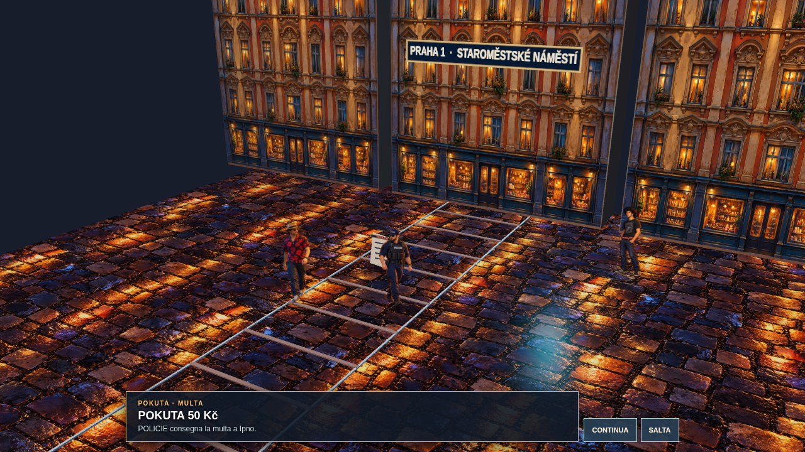 |

| Risultato e WhatsApp dopo l'uscita | Risultato e WhatsApp dopo la cattura |
|---|---|
| 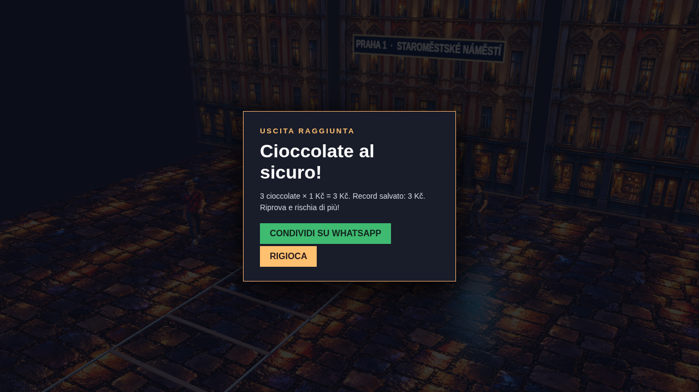 | 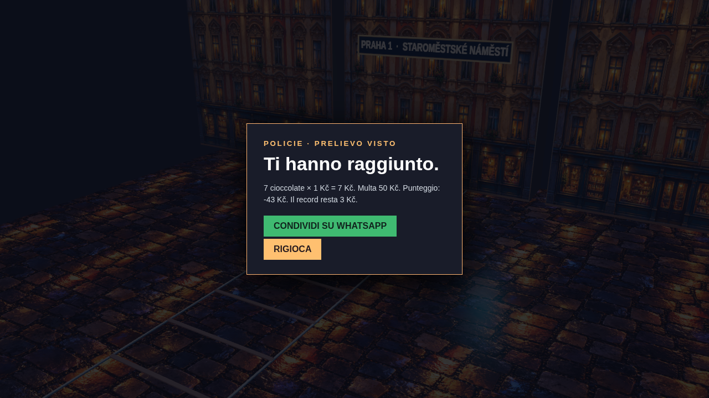 |

Le sei immagini sopra sono **screenshot autentici di Chromium 1280×720** del gioco renderizzato, con stato di prova riproducibile (3 cioccolate all'uscita; 7 alla cattura). [Scena in viewport mobile landscape 844×390](assets/reference-play/mobile-finale-street.png) e [risultato cattura mobile](assets/reference-play/mobile-finale-caught-result.png) sono anch'essi screenshot reali; non è stata usata una foto come fondale di gioco.

La tavola approvata guida sagome, costume di Ipno/POLICIE, contrasto caldo/freddo e camera obliqua. La miniatura del gruppo ha guidato solo il cast: Ipno entra da sinistra, quattro compagni lo attendono e Capellone è all'estremità destra; nella cattura Capellone ricompare **una sola volta**, in cameo con cintura di salame. Le facciate di Praga e il pavé sono texture WebP illustrate su geometrie 3D, con insegna della Città Vecchia, guglie e orologio nel set. L'ufficio e la scala mobile sono geometrie 3D animate semplici. **Scarti:** le facciate sono ripetute, gli attori rimangono sprite piani e la foto 200×128 limita i dettagli individuali dei compagni. Gli asset sono **provvisori e da approvare da Simone**. Le viewport browser non equivalgono a un test su Android fisico; le prestazioni del rendering software EC2 non rappresentano quelle del dispositivo.

## Revisione START e finali (#109)

| START originale nel browser desktop | START in viewport mobile landscape |
|---|---|
| 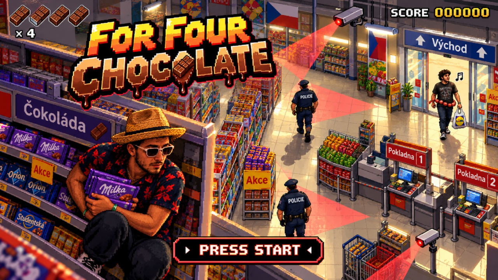 | 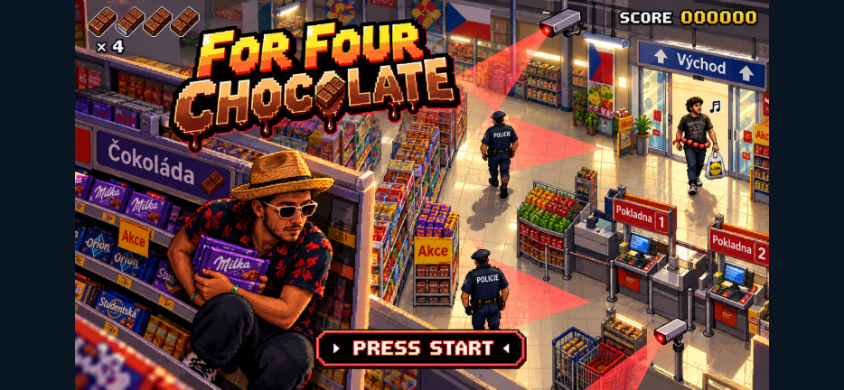 |

La schermata usa **direttamente e senza ricompressione** `references/start-screen-approved.jpg`. Le bande laterali nella viewport 844×390 conservano proporzioni, logo, Ipno e il `PRESS START` dipinto nell'originale. Una hitbox trasparente coincide con quel pulsante: non c'è una seconda scritta.

| Ufficio prima | Ufficio dopo |
|---|---|
|  | 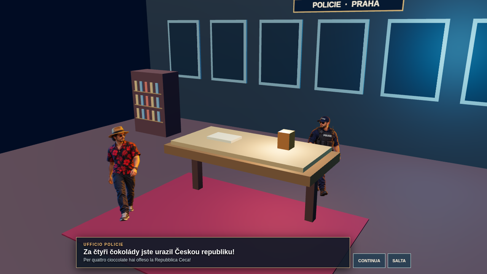 |

| Festa notturna e lontana prima | Festa di giorno davanti al supermercato dopo |
|---|---|
|  | 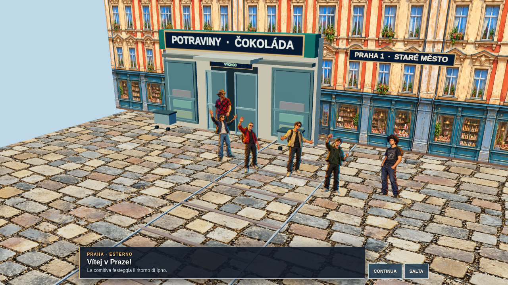 |

| Scala mobile prima | Ingresso, metà e uscita dopo |
|---|---|
|  | 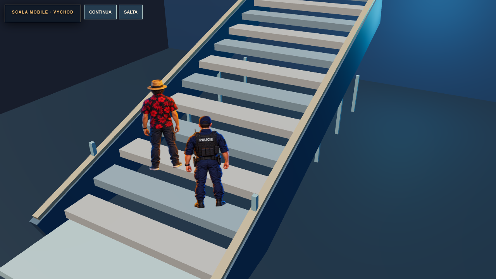 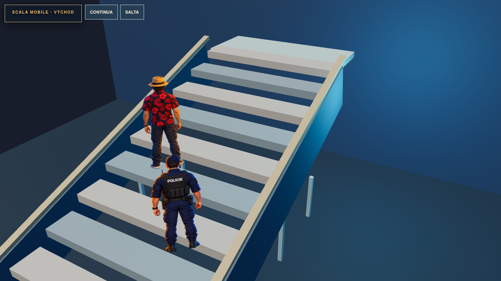 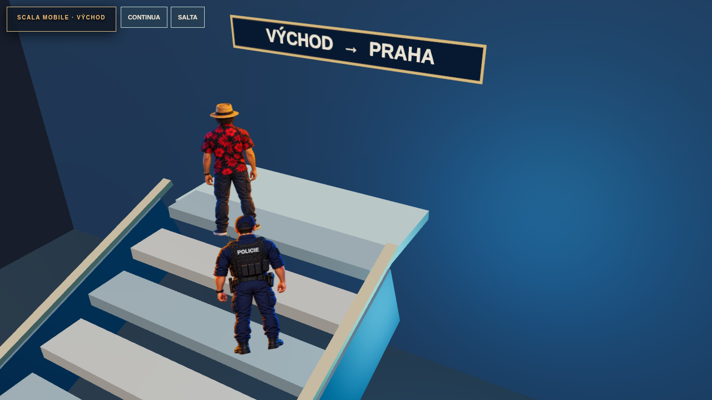 |

[Scala mobile mobile landscape](assets/reference-play/revision-escalator-mobile.png) · [Festa mobile](assets/reference-play/revision-street-mobile.png) · [Multa e cameo di giorno](assets/reference-play/revision-fine-day.png) · [Risultato positivo con WhatsApp](assets/reference-play/revision-success-result.png) · [Risultato cattura con WhatsApp](assets/reference-play/revision-caught-result.png).

Tutte le nuove immagini `revision-*.png` sono screenshot autentici del gioco in Chromium. La camera ora inquadra più da vicino personaggi e interazione; sulla scala segue l'ascesa e mostra le viste posteriori di Ipno/POLICIE con piedi sui gradini, non dentro la geometria. La città usa texture diurne derivate dalle precedenti risorse di Praga, porte e vetrine commerciali, insegne ceche e tram. Restano facciate ripetute, materiali semplificati per le vetrine e sprite piani. Il confronto mobile usa una viewport Chromium, non un Android fisico.
