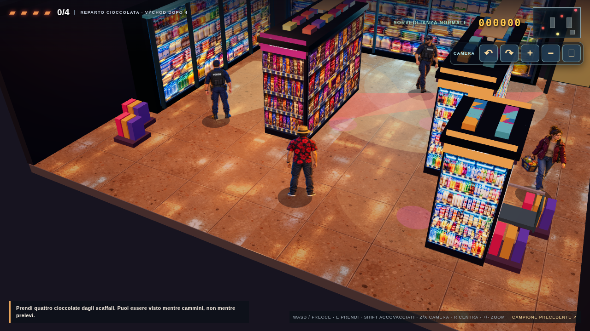
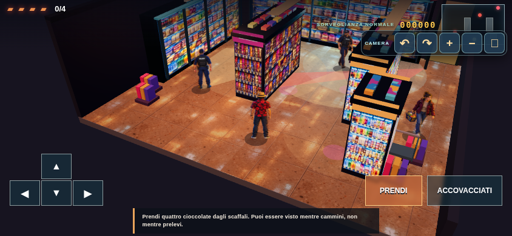
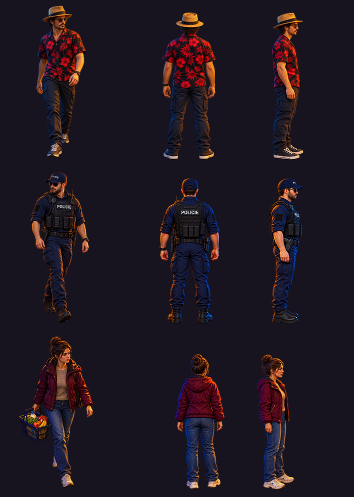

# Confronto visivo della prova giocabile (22 ottobre 2026)

| Unica tavola approvata | Screenshot reale del gioco, Chromium 1280×720 |
|---|---|
|  |  |

Questa prova si apre in `reference-play.html`. La tavola nel repository è un'anteprima WebP 720×405; l'originale ad alta risoluzione non era disponibile al momento del lavoro. Le immagini della tavola sono state usate **solo come riferimento**: non sono state incollate come fondale o UI del gioco.

## Valutazione franca

- **Camera e proporzioni:** vista alta obliqua ravvicinata su una porzione del negozio; Ipno, guardia, cliente e scaffali hanno scala umana simile alla tavola.
- **Colori e materiali:** frigoriferi freddi blu/ciano, cioccolata viola/rossa/oro, pavimento ambrato con riflessi e interno scuro. I materiali sono derivati dalla sola tavola approvata.
- **Gameplay visibile:** minimappa, pattuglia POLICIE, CCTV e coni rossi, cioccolata realmente sullo scaffale; movimento, copertura, prelievo e uscita sono interattivi.
- **Scarti ancora presenti:** gli scaffali sono 3D ma alcune facciate usano texture piane e ripetute; i personaggi sono piani illustrati in una scena 3D, ora con fronte, retro e profilo, senza un modello corporeo continuo da ogni angolo. Le due pose di camminata e la posa di prelievo sono ancora solo frontali. La densità e la profondità delle merci non raggiungono ancora la tavola. L'anteprima 720 px non permette di trasferire esattamente ogni dettaglio.
- **Prestazioni:** Chromium sul server EC2 usa rendering software e ha misurato 1–2 FPS; questa misura **non dimostra** le prestazioni su un telefono Android con GPU. Serve prova su dispositivo reale prima di dichiarare la resa mobile approvata.

**Aggiornamento dopo l'approvazione estetica di Simone (22/10):** la scena mostra quattro cioccolate su scaffali, due pattuglie e usa viste fronte/retro/profilo di Ipno, POLICIE e cliente. Le nuove viste seguono l'artboard, con costume e proporzioni confrontati alla stessa scala. Le geometrie e le texture degli scaffali sono ancora più ripetitive e meno profonde della tavola. Le viste laterali usano il riflesso per il lato opposto, e la cliente conserva un leggero alone scuro nei ritagli. Restano da misurare prestazioni e leggibilità su un telefono Android reale.

**Stato:** scena giocabile per revisione del gameplay. `index.html` resta il gioco precedente finché i lotti narrativi e di punteggio non saranno integrati.
