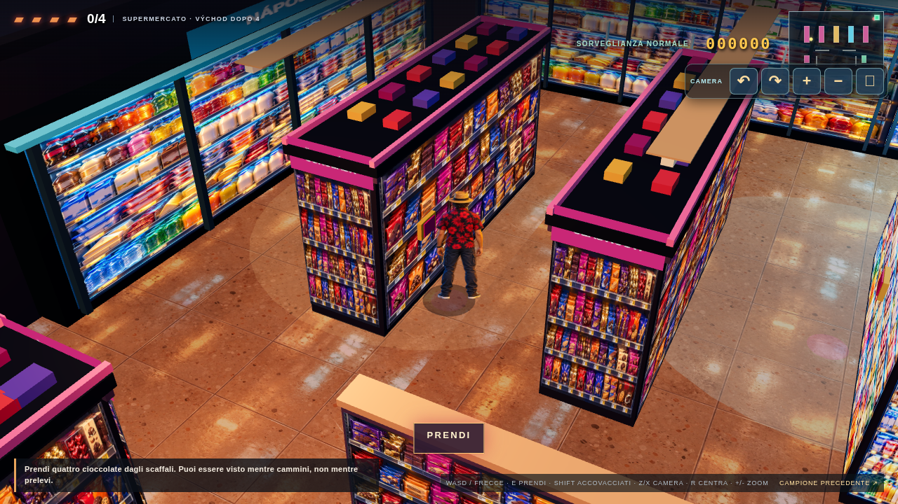

# Confronto visivo della prova giocabile (22 ottobre 2026)

| Unica tavola approvata | Screenshot reale del gioco, Chromium 1280×720 |
|---|---|
|  |  |

Questa prova si apre in `reference-play.html`. La tavola nel repository è un'anteprima WebP 720×405; l'originale ad alta risoluzione non era disponibile al momento del lavoro. Le immagini della tavola sono state usate **solo come riferimento**: non sono state incollate come fondale o UI del gioco.

## Valutazione franca

- **Camera e proporzioni:** vista alta obliqua ravvicinata su una porzione del negozio; Ipno, guardia, cliente e scaffali hanno scala umana simile alla tavola.
- **Colori e materiali:** frigoriferi freddi blu/ciano, cioccolata viola/rossa/oro, pavimento ambrato con riflessi e interno scuro. I materiali sono derivati dalla sola tavola approvata.
- **Gameplay visibile:** minimappa, pattuglia POLICIE, CCTV e coni rossi, cioccolata realmente sullo scaffale; movimento, copertura, prelievo e uscita sono interattivi.
- **Scarti ancora presenti:** gli scaffali sono 3D ma alcune facciate usano texture piane e ripetute; i personaggi sono piani illustrati in una scena 3D, senza un modello corporeo continuo da ogni angolo. La densità e la profondità delle merci non raggiungono ancora la tavola. L'anteprima 720 px non permette di trasferire esattamente ogni dettaglio. Le animazioni direzionali aggiunte nel lotto A sono descritte in fondo.
- **Prestazioni:** Chromium sul server EC2 usa rendering software e ha misurato 1–2 FPS; questa misura **non dimostra** le prestazioni su un telefono Android con GPU. Serve prova su dispositivo reale prima di dichiarare la resa mobile approvata.

**Aggiornamento dopo l'approvazione estetica di Simone (22/10):** la scena mostra quattro cioccolate su scaffali, due pattuglie e usa viste fronte/retro/profilo di Ipno, POLICIE e cliente. Le nuove viste seguono l'artboard, con costume e proporzioni confrontati alla stessa scala. Le geometrie e le texture degli scaffali sono ancora più ripetitive e meno profonde della tavola. Le viste laterali usano il riflesso per il lato opposto, e la cliente conserva un leggero alone scuro nei ritagli. Restano da misurare prestazioni e leggibilità su un telefono Android reale.

**Aggiornamento lotto A animazioni (22/10):** Ipno e POLICIE ora hanno quattro fotogrammi per camminata nelle quattro direzioni; Ipno ha passo accovacciato direzionale e prelievo fronte/retro/lato, gli agenti hanno corsa direzionale pronta per l'inseguimento. La [tavola di confronto delle animazioni](assets/reference-play/animation-comparison.png) mostra personaggi alla stessa scala; gli screenshot desktop e mobile qui sopra sono stati ricatturati dal gioco reale. Lo stile della tavola, i colori, le luci e la camera restano coerenti con la scena approvata. Persistono gli scarti strutturali già indicati: sprite piani, texture ripetute degli scaffali, tavola reference disponibile solo a 720 px. Nel browser software EC2 abbiamo misurato 1–2 FPS; un dispositivo Android reale non è stato ancora provato. Le pose di corsa verranno usate quando il lotto C introdurrà l'inseguimento.

**Stato:** scena giocabile per revisione del gameplay. `index.html` resta il gioco precedente finché i lotti narrativi e di punteggio non saranno integrati.

**Aggiornamento lotto B (22/10):** la superficie giocabile è passata da circa 114 a 440 m², con reparti cioccolato, dolci, alimentari, bevande, promozioni, frigoriferi e casse. Quattro espositori divisori aprono percorsi alternativi; alcuni scaffali diventano semitrasparenti solo quando coprono Ipno. Ci sono 18 posizioni candidate sui ripiani e 10 attive per partita; dopo 4 cioccolate si può uscire, le altre danno punti extra. Gli screenshot sopra sono stati ricatturati dalla mappa ampliata. Rispetto all'artboard approvata, la merce usa ancora texture ripetute e gli espositori aggiunti sono geometrici; le prestazioni su Android fisico restano da verificare.

**Aggiornamento lotto C (22/10):** l'interfaccia ora mostra chi ha visto il prelievo, le guardie che intervengono e l'ultima posizione nota sulla minimappa. Gli screenshot [POLICIE in inseguimento](assets/reference-play/policie-pursuit.png), [allarme CCTV desktop](assets/reference-play/cctv-alert.png) e [allarme CCTV mobile landscape](assets/reference-play/cctv-mobile-landscape.png) sono catture del gioco renderizzato in Chromium, con posizioni di prova impostate in modo riproducibile. La corsa usa gli sprite del lotto A; ambiente, personaggi e luce restano quelli derivati dalla sola artboard. L'unica camera CCTV e le facciate di scaffali ripetute restano una semplificazione rispetto alla ricchezza della tavola. Prova Android reale ancora mancante.
