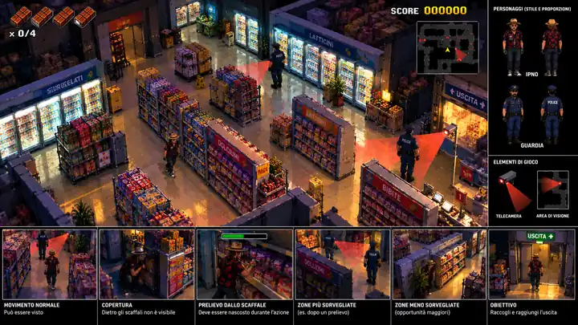

# FOR FOUR CHOCOLATE — Reference di gameplay e art direction (22 ottobre 2026)

## TAVOLA GRAFICA — REFERENCE CARICATA NELLA REPOSITORY

**File effettivo:** [references/gameplay-mgs-vr-artboard.webp](./references/gameplay-mgs-vr-artboard.webp) (anteprima WebP 720 px, compressa per la repository). L'illustrazione originale ad alta risoluzione è stata generata nella conversazione del 22 ottobre 2026.

**Attenzione:** usare questa tavola per camera/proporzioni, materiali, densità dei prodotti, palette, variazioni di sorveglianza e leggibilità dei personaggi. Le scritte italiane della tavola sono *etichette esplicative*: nel gioco il supermercato deve avere insegne in **ceco**. È una reference artistica, **non** uno screenshot del gioco né texture/fondale da incollare.

## 0. Stato e priorità
**Nuovo brief vincolante per il collaboratore.** L'attuale campione `sample-ps1.html` ha il giusto inizio tecnologico (Three.js, volumetria, camera obliqua), ma è ancora un *blockout* a parallelepipedi. L'utente ha bocciato esplicitamente i personaggi a «Pinocchio» e la resa C64. **Non basta arrotondare o aggiungere dettagli agli stessi manichini:** serve un nuovo linguaggio di modelli, proporzioni, texture e illuminazione.

**MGS VR Missions / Metal Gear Solid PS1 = reference per gameplay, telecamera e proporzioni.**
**Artwork coloratissimo di supermercato concordato in chat = reference per palette, texture, ricchezza di prodotti e luci.**
L'obiettivo è una scena videoludica *realmente giocabile* che combini i due, senza copiare la composizione pubblicitaria delle vecchie immagini.

## 1. Il fotogramma target
Una **schermata di gameplay 16:9 landscape**, ripresa alta inclinata alla Metal Gear Solid PS1/VR Missions, con camera abbastanza vicina da rendere leggibile una **porzione del supermercato**, non un modellino di tutto il negozio. Un corridoio nel reparto **frigoriferi / bevande e latticini** è il primo campione da realizzare.

- Ipno si trova **a metà scena**, in movimento o avvicinandosi a uno scaffale: altezza e scala plausibili rispetto ai frigoriferi e ai prodotti. Non in primo piano enorme, non una posa pubblicitaria accovacciata a tutta altezza.
- Cappello di paglia, occhiali, fisionomia, camicia fantasia e silhouette **riconoscibili dalle due fotografie reference**: proporzioni umane naturali, pose/animazioni credibili, modelli rifiniti. Un agente POLICIE ceco e una telecamera visibili, oltre a clienti sfumati nella vita quotidiana.
- Supermercato dettagliato: frigoriferi illuminati con ante a vetro, scaffali con confezioni diverse riconoscibili, carrelli, cestini, cartelli in ceco (`Nápoje`, `Mléčné výrobky`, `Čokoláda`, `Akce`, `Východ`), pavimento con riflessi controllati.
- Colori **vivi, caldi e saturi**, soprattutto confezioni viola/rosso/giallo/blu, luce frigo fredda in contrasto con luce generale ambra; ombre e superfici ricche. Stile grafico da **3D illustrato dettagliato**, non fotorealismo freddo e non pixel art semplice.
- Cono visivo della telecamera a pavimento (rosso trasparente), mentre una guardia controlla il corridoio; Ipno usa la copertura degli scaffali.
- HUD **piccolo e funzionale**: 0/4 cioccolate, punteggio/record, minimappa discreta. Controlli touch semi-trasparenti ai lati inferiori (movimento a sinistra, azione/prelievo, accovacciarsi/camminata a destra); non sovrastare la scena. **Non scrivere enorme “FOR FOUR CHOCOLATE” sopra il gameplay**.

## 2. Requisiti tecnici sul gameplay (nuova regola, 22 ottobre)
**La cioccolata NON si trova sul pavimento.** È inventario sullo scaffale; occorre un punto di interazione credibile.

- Movimento ordinario: Ipno può essere visibile a guardie e telecamere senza essere immediatamente catturato. Presenza nella corsia è normale; l'attenzione può crescere per comportamenti sospetti, ma non scatta un arresto automatico per semplice avvistamento.
- Prelievo: parte solo vicino al **corretto scaffale**, azionando `PRENDI`; ha una breve animazione e una finestra temporale.
- **Essere visto MENTRE preleva** fa fallire immediatamente il tentativo/arresto secondo bilanciamento definito; il giocatore deve cercare una finestra di invisibilità per tutta l'interazione. A differenza del movimento, la visibilità durante il prelievo è la condizione critica. Può esserci l'avviso `Troppo esposto` e blocco dell'azione se si è già visibili.
- Zone con **rischio differenziato**: corsie tranquille, casse più controllate, varchi/CCTV; pattuglie sensate e frequenza variabile.
- Dopo il prelievo, **la sorveglianza reagisce localmente**: inizialmente tranquilla, poi l'area dello scaffale appena svuotato diventa più presidiata, per mezzo di guardie e/o telecamere, e cambiano le rotte. Niente escalation universale uguale in ogni punto.
- Le quattro cioccolate vanno raccolte **da scaffali**, quindi fuga/uscita e record. Il cameo/epilogo restano nelle fasi successive.

## 3. Mobile e interazione
- **Solo landscape:** se il telefono è verticale, overlay `Ruota il dispositivo`; non forzare impossibili API di rotazione automatica.
- Due mani: stick virtuale analogico/D-pad a sinistra; tasti `PRENDI`, `ACCOVACCIATI` e pausa a destra.
- Touch target accessibili e traslucidi; HUD leggibile ma secondario rispetto alla scena, mantenere almeno 70% schermo utile al livello.
- Camera segue Ipno con controllo occlusione e semitrasparenza degli scaffali necessari; campo visivo delle telecamere tecnicamente coerente, non solo cono decorativo.

## 4. Cosa va **evitato** anche nella prossima generazione visuale
- NON ricreare per la quinta volta la stessa immagine con Ipno gigante accovacciato in primo piano sinistro.
- NON fare poster/logo o splash screen: serve una schermata **in game**.
- NON lasciare manichini costruiti con scatole/cilindri come personaggi finiti.
- NON dare a Ipno proporzioni da mascotte; altezza coerente con uno scaffale da supermercato.
- NON disegnare cioccolata sul pavimento come pickup.
- NON confondere il primo campione 3D col traguardo estetico.
- NON limitarsi a “leggermente più definito”: obiettivo è un salto di qualità percepibile in un fermo immagine gameplay.

## 5. Procedura di consegna
1. **Prima dello sviluppo completo**, offrire un nuovo fermo immagine grafico approvabile: uno screenshot **reale dal browser** del prototipo campione (non compositing), affiancato al riferimento illustrato di questa chat.
2. Nel prototipo, implementare soltanto **Ipno + 1 scaffale/frigo interagibile + 1 agente + 1 CCTV + copertura + indicatore PRENDI**. Proporzioni, materiali e telecamera hanno priorità su nuove feature.
3. Validare l'assenza di errori di console e la leggibilità in landscape Android, includendo screenshot desktop/mobile nella PR, senza merge automatico.
4. Mantenere il vecchio sample/prototipo accessibile per confronto e aggiornare `WORK_LOG.md`.

La futura immagine ImageGen generata in conversazione è una **reference di art direction**, non un asset direttamente integrabile: **non** tentare di applicarla come unico sfondo statico se servono interazioni e visibilità reali.

**Precedenza:** questo file prevale su ogni antica istruzione sulla pixel art 24×40 e integra `DIREZIONE_ARTISTICA_PS1.md` con le regole più recenti sul prelievo.
