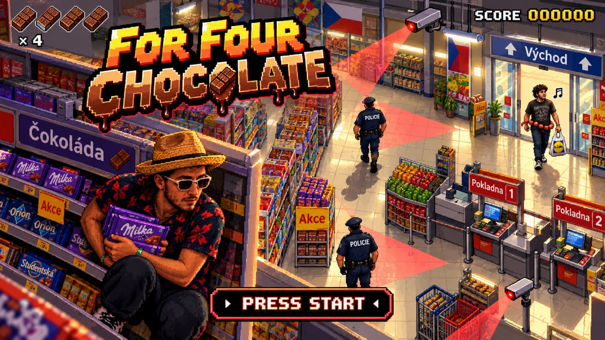

# For Four Chocolate — revisione START e scene finali
**Richiesta utente del 22 ottobre 2026. Assegnata al collaboratore; da implementare tramite PR, non già realizzata.**

## 0. Regola generale e reference
- Gameplay continua a rispettare l'[unica reference artistica](./references/gameplay-mgs-vr-artboard.webp), come impone [AGENTS.md](./AGENTS.md). **Eccezione esplicita per la title screen:** l'utente ha approvato una **nuova immagine specifica esclusivamente per la schermata START** (immagine 1536 × 864 fornita nella conversazione del 22 ottobre 2026, con logo grande `FOR FOUR CHOCOLATE`, Ipno con cappello accucciato dietro gli scaffali, guardie POLICIE e CCTV con coni rossi, cartelli cechi, gruppo umano in fondo e pulsante `PRESS START`). **Questa reference della schermata START non sostituisce la tavola approvata del gameplay**.
- **IMMAGINE START ORIGINALE DISPONIBILE IN REPOSITORY:** \n\nUsare **esattamente** [references/start-screen-approved.jpg](./references/start-screen-approved.jpg), file originale a risoluzione **1536×864** (JPEG, 461.692 byte) allegato dall'utente, senza reimmaginare né generare un altro poster. Il file, pur caricato originariamente con nome `.png` nella conversazione, è codificato JPEG: l'estensione `.jpg` nella repo è intenzionale e corretta.
- Tutti gli asset e le scene finali restano in stile coerente con il gameplay, tranne la title screen che usa la nuova immagine approvata.
- L'attuale partita ha prelievi illimitati e uscita volontaria sempre consentita: titolo e testo `For Four Chocolate` sono una gag e non devono ripristinare la regola dei soli quattro pezzi. Eventuali 4 tavolette disegnate sulla cover appartengono all'artwork, non all'HUD reale durante la partita.

## 1. Start screen ufficiale
1. All'avvio di `reference-play.html` presentare una **schermata iniziale 16:9 landscape** che mostra l'immagine approvata. Deve essere nitida, ben inquadrata e senza tagli impropri a Ipno, logo o pulsante `PRESS START` (letterbox/crop responsive controllato per i diversi aspect ratio).
2. Aggiungere **PRESS START** interattivo su un'area accessibile touch e tastiera (Enter/Spazio o click/tap), mantenendo l'aspetto grafico dell'immagine. Se necessario sovrapporre hitbox trasparente accessibile a `PRESS START` già disegnato, senza creare scritte doppie.
3. Caricare la scena 3D in modo robusto: preloading e feedback solo se necessario; Start → gameplay senza ricaricamenti superflui, niente pausa involontaria, nessun loop di avvio. Il gameplay non deve muoversi/contare tempo finché Start è attivo.
4. A fine partita, `RIGIOCA` deve tornare alla nuova schermata START o offrire una scelta evidente per un nuovo tentativo; testare gestione reset, record e joystick.
5. La title screen rimane specifica del gioco; non modificare design di altri giochi dell'arcade.

## 2. Zoom delle cutscene: personaggi più leggibili
Le attuali scene sono troppo larghe: avvicinare **e ricomporre la camera** per mostrare protagonisti, espressioni, gesti e oggetti narrativi.
- **Ufficio POLICIE:** campo medio ravvicinato che mette in evidenza Ipno, poliziotto, scrivania e battuta in ceco con sottotitoli; non zoom cieco su un punto vuoto.
- **Scala mobile:** camera che segue/scorre con la salita, mostra **corpo intero, piedi e gradini corretti**, non soffocare l'attore fuori frame.
- **Festa finale:** campo medio, Ipno che si avvicina e comitiva leggibile; non duplicare Ipno né Capellone (sono già nella reference fotografica del gruppo). Riprese di gruppo leggibili su schermi mobili.
- **Multa/cameo:** scena esterna sufficientemente vicina per vedere consegna della multa e, sullo sfondo, Capellone con la **cintura di salame**, senza trasformarlo nel protagonista.
- **Vincolo tecnico:** inquadrare su attori e interazione reale, via rig/camera target configurato per ogni scena (non solo cambiare globalmente la FOV); preservare proporzioni e continuità tra shot e titoli.

## 3. Praga: esterno luminoso, ma uscita riconoscibile da supermercato
- È **GIORNO**, con colori luminosi, ombre leggibili e cielo/illuminazione credibili; **non** Praga buia/notturna.
- Si deve riconoscere **Praga** tramite facciate, tram/segnali urbanistici, targhe/segni cechi coerenti o uno scorcio architettonico tipico visibile in lontananza. Evitare un panorama generico ma anche un'uscita monumentale.
- **Ipno esce fisicamente dalle porte di un supermercato commerciale**, eventualmente vetrate e insegna con `VÝCHOD` / supermercato, carrelli, espositori, vetrine, cartellonistica. **Non deve sembrare che esca da una cattedrale/chiesa**. Edificio e geometrie devono essere direttamente coerenti con l'interno del gioco e con la transizione dall'uscita.
- La stessa uscita del supermercato è riconoscibile sia nel finale volontario/festa sia dopo la cattura (dopo ufficio + scala mobile). Le due situazioni sono distinte narrativamente, ma restano nello stesso mondo.

## 4. Bug scala mobile — gambe tagliate
Problema osservato sul render corrente: il personaggio sembra **troncato all'altezza delle gambe** mentre sale sulla scala mobile.
- Correggere **depth sorting, layering, pivot piedi, occlusione, gradini e ringhiera**, controllando i materiali trasparenti/sprite e l'intersezione geometrica. La scala mobile deve avere pianerottolo d'ingresso/uscita, gradini in movimento e profondità visivamente consistente.
- Mostrare che Ipno è *sui* gradini e sale verso l'alto, **non dentro** il pavimento; piedi, gambe e corpo devono essere sempre leggibili nel movimento e nelle inquadrature laterali/oblique.
- Se la sprite è un billboard in 3D, correggere piede-pivot e mascheratura dell'attore sui gradini; non risolvere occultando ancora di più il busto o tagliando parte del corpo.
- Verificare a fotogrammi successivi (almeno ingresso, metà scala e uscita) e su viewport Android landscape: **nessun personaggio dimezzato**.

## 5. Due finali e WhatsApp restano obbligatori
Le correzioni sono integrazione a [FINALI_E_CONDIVISIONE.md](./FINALI_E_CONDIVISIONE.md) e non sostituiscono le sequenze:
- **Successo:** uscita spontanea → esterno supermercato a Praga **di giorno** → festa della comitiva → risultato.
- **Cattura:** intervento fisico POLICIE → ufficio con `Za čtyři čokolády jste urazil Českou republiku!`, poi `For four chocolate!` → scala mobile senza glitch → supermercato/Praga di giorno → multa 50 Kč → cameo di Capellone con cintura di salame → risultato.
- **Entrambi:** pulsante **Condividi su WhatsApp** con messaggi distinti e dati reali del punteggio, record e URL pubblico; non regredire le funzionalità già in PR #108.

## 6. Criteri di accettazione per la PR
- [ ] Schermata `START` con l'**immagine esatta approvata** (non altra), raggiungibile in browser e attivabile tramite tastiera + tap; nessuna grafica rovinata da resize e nessun gameplay prima di Start.
- [ ] **Screenshot reali**: Start desktop + landscape 844×390, ufficio ravvicinato, scala mobile ingresso/metà/uscita senza gambe tagliate, festa ravvicinata, esterno Praga di giorno con **vetrina/porta supermercato**.
- [ ] Confronto visivo prima/dopo delle tre scene (ufficio, scala, festa) con personaggi nettamente più leggibili.
- [ ] Finale positivo senza doppioni, finale negativo con multa e cameo, bottino/record invariati, WhatsApp accessibile **in entrambe** le schermate.
- [ ] Test Node di scene/stati e transizioni, test Chromium desktop/mobile landscape senza JS error/overflow, eventuale test Android reale segnalato con onestà.
- [ ] PR dedicata e `WORK_LOG.md` aggiornato; **non fare merge autonomo**.

**Immagine START ora caricata su `main`:** [references/start-screen-approved.jpg](./references/start-screen-approved.jpg), fedele byte-per-byte alla foto/immagine allegata nella conversazione corrente del 22/10/2026, 1536×864, logo giallo/rosso `FOR FOUR CHOCOLATE` a sinistra, Ipno in camicia nero/rossa con cioccolate in primo piano e pulsante `PRESS START` in basso al centro. La tavola artistica unica del gameplay rimane valida per il resto.

**Esito/Stato 22/10/2026:** la revisione #109 è preparata sul ramo `ffc-start-finali` per PR separata. Il file `references/start-screen-approved.jpg` è usato direttamente e senza ricompressione; test Chromium desktop/mobile landscape e 36 test Node superati, screenshot autentici in `assets/reference-play/revision-*.png`. Android fisico resta da provare. Le caselle rimangono aperte fino a merge e collaudo di Simone.
